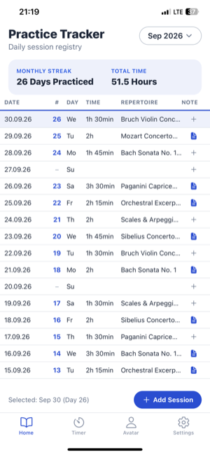
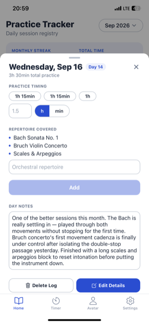
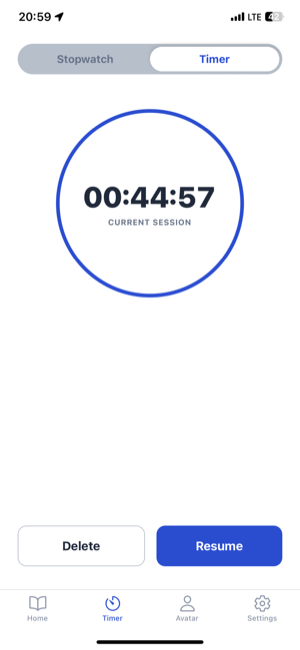
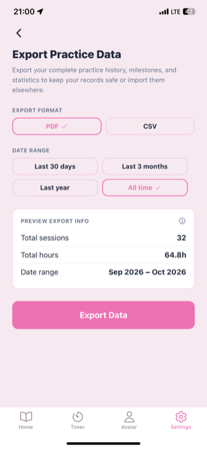

# Practice Tracker

An iOS app for musicians to log daily practice sessions, time them, and review monthly totals.

[Download on the App Store](https://apps.apple.com/app/practice-tracker-for-musicians/id6816482349)

<p>
  
  
  
  
</p>

## Features

- **Practice log**: a month-by-month table of days with practice time, repertoire and notes. Each day has its own detail view where you add timed blocks, repertoire pieces and notes.
- **Timer**: a stopwatch and a countdown timer. Recorded time is saved to that day's session.
- **Statistics**: the number of days practiced and the total practice time for the selected month.
- **Export**: PDF or CSV export for the last 30 days, last 3 months, last year or all time, shared through the iOS share sheet.
- **Notifications**: a daily practice reminder at a chosen time and an alert when a countdown session ends (local notifications).
- **Themes**: three color themes (Classical, Dark, Rose) and a choice of instrument for the profile.
- **Authentication**: Sign in with Apple, Google Sign-In, or email and password, including password reset with an emailed code.
- **Account deletion**: deletes the account and all of its data in the app. For Apple accounts, the app also revokes the Sign in with Apple grant.

## Tech stack

- **App:** React Native 0.86, Expo SDK 57 (dev client, EAS Build), TypeScript
- **State and navigation:** Zustand, React Navigation 7 (bottom tabs + native stack)
- **Backend:** Supabase (Postgres, Auth, Row Level Security, Edge Functions on Deno)
- **Native modules:** expo-apple-authentication, @react-native-google-signin/google-signin, expo-notifications, expo-print, expo-sharing, expo-secure-store, expo-iap (StoreKit 2)

## Architecture

```
screens/  →  hooks/ + store/  →  repositories/  →  Supabase
  UI          React hooks and     interfaces/ + a      Postgres + Auth
              Zustand stores      supabase/ impl.      + Edge Functions
```

- **Screens** render the UI and get their data only through hooks and stores.
- **Hooks / stores** (`useAuth`, `useSessions`, `useProfile`; Zustand stores) hold app state and call repositories.
- **Repositories** have interfaces in `repositories/interfaces/` and Supabase implementations in `repositories/supabase/`. UI code never calls the Supabase client directly.
- **Security model:** the app only uses the public anon key. Every table (`profiles`, `sessions`, `session_timings`, `repertoire`, `purchases`) has Row Level Security that limits each user to their own rows. The full schema is in [`supabase/schema.sql`](supabase/schema.sql).
- **Edge Functions** handle the work that needs server-side secrets:
  - [`delete-account`](supabase/functions/delete-account/index.ts): revokes the Sign in with Apple grant (when relevant), then deletes the auth user. Related data is removed by cascading foreign keys.
  - [`verify-purchase`](supabase/functions/verify-purchase/index.ts): verifies a StoreKit 2 transaction with the App Store Server API, records it, and unlocks full access. The `unlocked` column can't be written from the client, only from this function.
- **Paywall flag:** in-app purchase is implemented but switched off by `PAYWALL_ENABLED = false` in [`lib/features.ts`](lib/features.ts). It is planned to be enabled in the next version.

## Getting started

Requirements: Node.js, an Apple Developer account and an iPhone (the app uses native modules, so it runs in a development build, not Expo Go), plus a Supabase project.

1. Install dependencies:
   ```bash
   npm i
   ```
2. Create the environment file and fill in your Supabase URL, anon key and Google OAuth client IDs:
   ```bash
   cp .env.example .env
   ```
   The Google iOS URL scheme in `app.config.js` must match your own iOS OAuth client.
3. Apply the database schema: open the Supabase Dashboard → SQL Editor and run [`supabase/schema.sql`](supabase/schema.sql).
4. Deploy the Edge Functions and set their secrets. These are never stored in the repository:
   ```bash
   supabase functions deploy delete-account --project-ref <ref>
   supabase functions deploy verify-purchase --project-ref <ref>
   supabase secrets set --project-ref <ref> \
     APPLE_SIGNIN_KEY_ID=... APPLE_SIGNIN_TEAM_ID=... APPLE_SIGNIN_PRIVATE_KEY="$(cat AuthKey_XXXX.p8)" \
     APPLE_IAP_KEY_ID=... APPLE_IAP_ISSUER_ID=... APPLE_IAP_PRIVATE_KEY="$(cat AuthKey_YYYY.p8)"
   ```
5. Build and install a development client, then start Metro:
   ```bash
   npx eas-cli build --profile development --platform ios
   npx expo start --dev-client
   ```

## License

Copyright (c) 2026 Amangali Imanzhan. All Rights Reserved. The source is published for viewing only. See [LICENSE](LICENSE).
